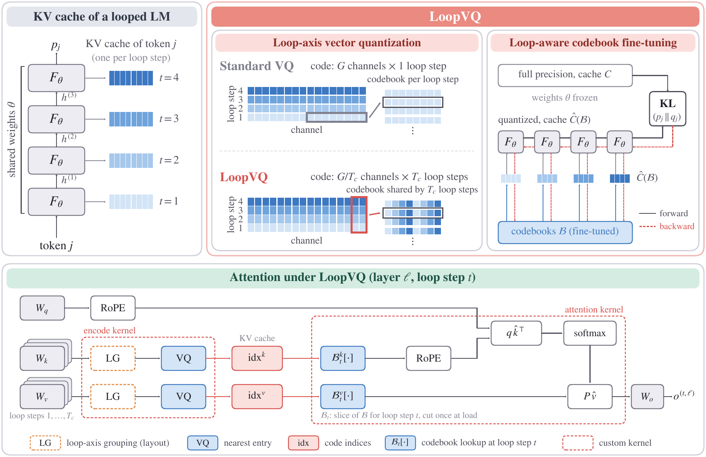
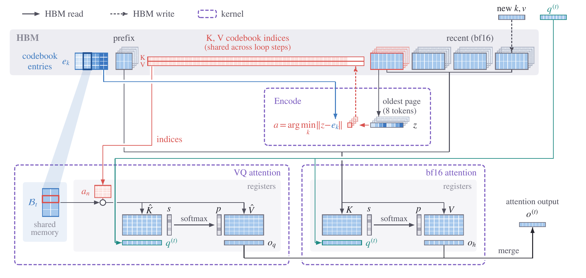

<div align="center">

# LoopVQ

### Sub 1-bit KV Cache Quantization for Looped Transformers

<a href="https://mscheong01.github.io/loopvq/"></a>
&nbsp;
<a href="https://arxiv.org/abs/2611.05304"></a>

**[Project Page](https://mscheong01.github.io/loopvq/)** · **[Paper](https://arxiv.org/abs/2611.05304)** · [Overview](#overview) · [Supported Quantization Methods](#supported-quantization-methods) · [Quick Start](#quick-start) · [Experiments](#experiments) · [Repository Layout](#repository-layout)

</div>

<p align="center">
  
</p>

## Overview

Looped transformers reuse one block of layers over several loop steps, and every loop step keeps its
own KV cache, so the cache grows with the number of loop steps. LoopVQ is a vector quantization
method for this cache:

- **Loop-axis vector quantization** groups channels of several consecutive loop steps into one
  sub-vector, so one codebook index is shared by multiple loop steps. The keys and values of a layer
  are strongly correlated across loop steps, so this lowers the reconstruction error at the same
  bitwidth.
- **Loop-aware fine-tuning** refines the Fisher-weighted k-means codebooks by matching the output of
  the quantized model to that of the full-precision model, with every loop step reading the
  quantized cache, which accounts for the different quantization sensitivities of the loop steps.

LoopVQ combines with TaSQ's key transforms (TaSQ+LoopVQ). The repository contains the calibration
pipeline, an SGLang-based serving engine with packed index storage and fused decode kernels, and the
scripts for every table in the paper on Ouro-1.4B / 2.6B (base and Thinking) and Huginn-3.5B.

## Supported Quantization Methods

All quantized methods store each key and value as 8-bit codebook indices over sub-vectors, with
codebooks fit by Fisher-weighted k-means on the calibration set. Every script takes the method names
below, with the bitwidth per element as the suffix: 0.5 and 0.25 bit in the main tables, 4, 2, and
1 bit in the bitwidth sweep.

| Method | Name | One code covers | K / V bits per element (0.5 bit) |
|---|---|---|---:|
| BF16 | `bf16` | (full-precision KV cache) | 16 / 16 |
| CQ | `cq_0.5bit`, `cq_0.25bit` | G channels of one loop step | 0.5 / 0.5 |
| TaSQ | `tasq_0.5bit`, `tasq_0.25bit` | G channels of one loop step, with TaSQ's key transforms | 0.508 / 0.5 |
| **LoopVQ** | `loopvq_0.5bit`, `loopvq_0.25bit` | G/4 channels x 4 loop steps, loop-aware fine-tuning | 0.5 / 0.5 |
| **TaSQ+LoopVQ** | `tasq_loopvq_0.5bit`, `tasq_loopvq_0.25bit` | LoopVQ with TaSQ's key transforms | 0.508 / 0.5 |

G = 16 elements at 0.5 bit and 32 at 0.25 bit. On Huginn-3.5B a LoopVQ code covers 4 of the 32
recurrences. Every quantized method keeps the first and the most recent tokens in bf16: 8 and 64 on
the general benchmarks, 64 and 256 on the reasoning and long-context benchmarks. Bundles and results
are stored under internal arm names (`loopvq_0.5bit` is `loopvq8b_g16_lvgqe2e`), and
[`scripts/arms.sh`](scripts/arms.sh) maps one to the other.

## Quick Start

### Setup

```bash
git clone <this repository> loopvq && cd loopvq
./setup_envs.sh          # loopvq-serve (engine), loopvq-eval (lm_eval / EvalPlus client), loopvq-build (calibration)
export MODELS_DIR=/path/to/models   # holds Ouro-1.4B, Ouro-2.6B, Ouro-*-Thinking, huginn-0125 (default: ./models)
```

### Reproducing a table

The general-benchmark table for Ouro-1.4B:

```bash
# 1. Build the bundles (CQ, TaSQ, LoopVQ, TaSQ+LoopVQ at 0.5 and 0.25 bit), loopvq-build env.
conda activate loopvq-build
MODEL=ouro_1p4b GPUS="0 1 2 3" bash experiments/loopvq_general/build.sh

# 2. Run every (benchmark, method) cell; servers are launched and torn down automatically.
#    Cells already in outputs/ are skipped, so the script can be re-run after an interruption.
MODEL=ouro_1p4b bash experiments/loopvq_general/run_all.sh

# 3. Render the table (table.md / table.tex / table.png).
python3 experiments/loopvq_general/make_table.py
```

One cell at a time:

```bash
bash experiments/loopvq_general/scripts/ouro_1p4b__gsm8k_cot_3shot.sh bf16 loopvq_0.5bit
```

Calibration uses 16 sequences of 2,048 tokens from the GPQA main set excluding the Diamond subset.
Bundles land in `experiments/artifacts/<model>_<arm name>/`, calibration buffers in `work/calib_cache/`
(`CALIB_CACHE_DIR`). Serving and protocol settings are documented in [`config.sh`](config.sh).

### Serving

```bash
conda activate loopvq-serve
# BF16
./scripts/serve_method.sh $MODELS_DIR/Ouro-1.4B bf16 . --port 30000
# LoopVQ, 0.5 bit: the bundle directory holds the K and V codebooks (scripts/arms.sh for the name)
PREFIX_TOKENS=8 RECENT_TOKENS=64 PREFILL_BACKEND=triton \
  ./scripts/serve_method.sh $MODELS_DIR/Ouro-1.4B vq experiments/artifacts/ouro_1p4b_loopvq8b_g16_lvgqe2e \
  --port 30000 --disable-piecewise-cuda-graph
```

`PREFIX_TOKENS` and `RECENT_TOKENS` set the bf16 sink and recent windows. The server speaks the
OpenAI-compatible API of SGLang. [`scripts/serve_method.sh`](scripts/serve_method.sh) lists the
other knobs, and `arm_spec` in [`scripts/run_sweep.sh`](scripts/run_sweep.sh) the settings each
method is served with in the experiments.

The KV cache keeps the sink and recent tokens in bf16 at every loop step and all other tokens as
codebook indices shared across loop steps. At loop step t, the LoopVQ attention kernel loads that
loop step's slice of the codebook into shared memory and looks up keys and values from the indices;
its output is merged with that of the bf16 attention over the sink and recent tokens. After every 8
generated tokens, the oldest recent page is encoded into indices.

<p align="center">
  
</p>

## Experiments

| Table | Directory | Models | Benchmarks |
|---|---|---|---|
| General | [`experiments/loopvq_general`](experiments/loopvq_general) | Ouro-1.4B, Ouro-2.6B, Huginn-3.5B | GSM8K, MATH500, HumanEval, MBPP (EvalPlus base tests) |
| Reasoning | [`experiments/loopvq_reasoning`](experiments/loopvq_reasoning) | Ouro-{1.4B,2.6B}-Thinking | AIME'24, AIME'25, GPQA-Diamond, HumanEval+, MBPP+ (3 seeds) |
| Long-context retrieval | [`experiments/loopvq_niah`](experiments/loopvq_niah) | Ouro-1.4B, Ouro-2.6B | RULER NIAH, 4k to 64k |
| LongBench | [`experiments/loopvq_longbench`](experiments/loopvq_longbench) | Ouro-1.4B, Ouro-2.6B | 16 English LongBench tasks |
| Ablations | [`experiments/loopvq_ablation`](experiments/loopvq_ablation) | Ouro-1.4B | components, calibration set and size, FT objective |
| Bitwidth sweep | [`experiments/bit_sweep`](experiments/bit_sweep) | Ouro-2.6B | 1, 2, and 4 bits (0.25 / 0.5 from the general table) |
| Efficiency | [`experiments/loopvq_efficiency`](experiments/loopvq_efficiency) | Ouro-{1.4B,2.6B}-Thinking | decode / prefill latency, throughput, time profile |

## Repository Layout

```text
loopvq/
├── calibration/               bundle building: Fisher k-means, loop-aware fine-tuning, TaSQ transforms
├── experiments/               one directory per paper table (build.sh, run_all.sh, scripts/, make_table.py)
├── python/                    SGLang fork: packed VQ KV cache, Triton decode kernels, Ouro / Huginn
├── scripts/                   serving, sweep, and evaluation clients
├── tasks/                     lm_eval task definitions and the NIAH row builder
├── config.sh                  serving and protocol configuration
└── setup_envs.sh              environment setup
```

## License

This repository is released under the [Apache License 2.0](LICENSE). Third-party components retain
their original terms; see [NOTICE](NOTICE) for attribution.
